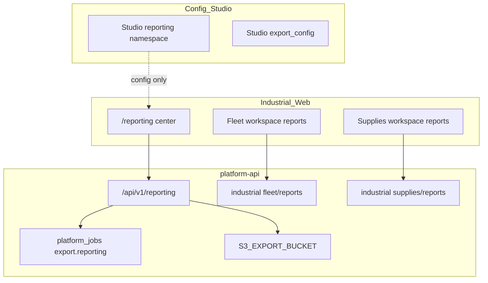

# Industrial Reporting System — Gap Analysis

**Status:** Pass 1–4 engine + Industrial Web UI shipped; polish includes S3 large exports, schedule `run-due` with notifications mailer delivery, templates/settings IA, and Fleet/Supplies report tabs pointing at Reporting Center. Remaining: deeper custom-builder (charts/aggs), formal field registry, optional EventBridge cron for run-due, full SES sendFn wiring if not already live.  
**Vision source:** [REPORTING-SYSTEM.md](./REPORTING-SYSTEM.md) (§1–§94)  
**Scope:** Industrial Web Reporting (`/reporting`) vs platform `/api/v1/reporting`, module-local builders, Configuration Studio

---

## 1. Executive summary

Industrial Reporting is a **shipped V1 Reporting Center**, not a stub.

Primary UX is `/reporting` (legacy `/modules/reporting/` redirects). Platform API exposes `/api/v1/reporting/*` with catalog adapters, run/export (CSV + XLSX + PDF), saved definitions, favorites, history, schedules, shares, settings, and due-schedule execution. DB tables `report_definitions`, `report_favorites`, `report_executions`, `report_exports`, `report_schedules`, `report_recipients`, and `report_shares` are live (migration `0076` + `0079` for large-export S3/job columns). Permissions `industrial.reporting.*` are seeded.

**Still open vs vision:** Fleet/Supplies still ship module-local builders (should become adapters), email delivery for schedules is audited-but-stubbed, custom builder lacks full wizard depth (charts/aggs/relative dates), and deeper custom-field registry work remains.

| Layer | Role today |
| --- | --- |
| Industrial `/reporting/*` | Reporting Center IA: overview, library, builder, templates, saved, scheduled, favorites, compliance, exports, history, analytics, settings |
| Fleet / Supplies workspaces | Local CSV/print builders remain (migrate to central engine) |
| Studio `reporting` / `export_config` | Config payloads only — not the execution engine |
| `platform-api` | Central `/api/v1/reporting/*` + module-scoped fleet/supplies report endpoints |
| DB | Vision report_* tables + S3/job link on exports |

---

## 2. Architecture map

**Evidence**

- Center: `apps/industrial-web/src/app/reporting/**`
- Engine: `apps/platform-api/src/modules/reporting/**`
- Schema: `packages/database/src/schema/reporting.ts`
- Fleet builder: `apps/industrial-web/src/components/fleet-custom-report-builder.tsx`
- Supplies builder: `apps/industrial-web/src/components/safety-supplies-report-builder.tsx`
- Vision: `docs/industrial/REPORTING-SYSTEM.md`

---

## 3. Status rubric

| Status | Meaning |
| --- | --- |
| **Shipped (Industrial)** | Usable under Industrial Reporting center today |
| **Shipped elsewhere** | Exists inside another module workspace or print/export flow |
| **Shipped (Studio)** | Studio namespace/config only; not an execution engine |
| **Partial** | Related UI/API exists but missing depth, IA, or centralization |
| **Stub** | Page or route exists with placeholder / non-functional core |
| **Gap** | No meaningful implementation |

---

## 4. IA matrix (vision §1–§2)

| Vision nav / route | Status | Evidence / notes |
| --- | --- | --- |
| `/reporting` Overview | Shipped (Industrial) | KPI overview + shortcuts |
| Report Library | Shipped (Industrial) | Search/filter, run, export, favorite |
| Custom Report Builder | Partial | Multi-step save/preview under `/reporting/builder`; not full vision wizard |
| Saved Reports | Shipped (Industrial) | Tenant `report_definitions` origin=saved |
| Scheduled Reports | Shipped (Industrial) | CRUD + `POST /schedules/run-due`; email delivery stubbed |
| Compliance Reports | Shipped (Industrial) | Compliance filter / suite page |
| Analytics Reports | Partial | Analytics page + monthly stats adapter |
| Exports | Shipped (Industrial) | Export center; inline + S3 large artifacts via `export.reporting` jobs |
| Report History | Shipped (Industrial) | Execution history |
| Templates | Shipped (Industrial) | Save builtin as template; list tenant templates |
| Settings | Shipped (Industrial) | Defaults, permissions, run-due control |

---

## 5. Capability themes vs current state

### Overview & library (§3–§8)

| Spec item | Status | Evidence / notes |
| --- | --- | --- |
| Reporting Center header / CTAs | Shipped (Industrial) | `/reporting` shell |
| KPI cards (saved, scheduled, runs, compliance) | Shipped (Industrial) | `GET /overview` |
| Favorites / Recently Run / Scheduled preview | Partial | Favorites + history pages; overview shortcuts |
| Report Library + search/filters/categories | Shipped (Industrial) | Library + catalog adapters |

### Built-in standard reports (§9–§27)

| Domain | Status | Evidence / notes |
| --- | --- | --- |
| Safety / Incidents / OSHA | Partial | Builtin adapters + compliance page; not every OSHA package |
| DOT / Training / Personnel / CAPA / Fleet / Supplies | Partial | Catalog keys + adapters; Fleet/Supplies local builders still parallel |
| Remaining specialty modules | Gap / module ops only | Register as adapters over time |

### Custom Report Builder (§28–§37)

| Spec item | Status | Evidence / notes |
| --- | --- | --- |
| Wizard depth | Partial | Source → fields → filters → name → preview/save |
| Charts / aggregations / relative dates | Gap | — |
| Server-side preview/run | Shipped (Industrial) | Adapter run path; no client SQL |

### Saved / schedule / delivery / share (§38–§48)

| Spec item | Status | Evidence / notes |
| --- | --- | --- |
| Saved reports (tenant DB) | Shipped (Industrial) | — |
| Schedules + recipients | Shipped (Industrial) | Schedules + recipients; `run-due` executes and emails via notifications mailer |
| Sharing / favorites | Shipped (Industrial) | — |

### Export & history (§50–§53)

| Spec item | Status | Evidence / notes |
| --- | --- | --- |
| Export Center (PDF / XLSX / CSV) | Shipped (Industrial) | — |
| Large async / S3 exports | Shipped (Industrial) | Inline cap ~1.5MB; larger → S3 + `export.reporting` job + download API |
| Report execution history | Shipped (Industrial) | — |

### Permissions, isolation, registries (§55–§62)

| Spec item | Status | Evidence / notes |
| --- | --- | --- |
| `industrial.reporting.*` permission set | Shipped (Industrial) | Seeded + enforced |
| Dataset / field registry + module registration | Partial | Builtin catalog; formal registry still thin |
| Tenant custom fields in reports | Gap | — |
| Cross-module reports | Partial | Adapters per module; limited joins |

---

## 6. Recommended next increments

1. Ensure production `FORGE_EMAIL_PROVIDER=ses` + live SES `sendFn` if emails must leave noop.
2. Optional EventBridge/cron calling `POST /api/v1/reporting/schedules/run-due` per tenant (or platform sweep).
3. Deepen custom builder (relative dates, charts, aggregations).
4. Formal dataset/field registry for custom fields.
5. Retire Fleet/Supplies localStorage builders once tenants migrate saved templates into Reporting.

---

## 7. Historical note

Pass 1 of this document described a stub `/modules/reporting` and missing `/api/v1/reports/*`. That state is obsolete as of the Reporting Engine ship (2026-09-04). Prefer sections 1–6 above for current planning.
