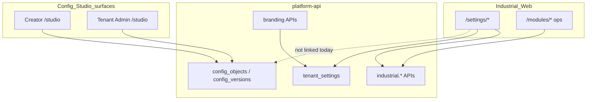

# Industrial Tenant Settings — Gap Analysis

**Status:** Documentation inventory (2026-09-04)  
**Vision source:** [TENANT-SETTINGS-CONFIGURATION-SYSTEM.md](./TENANT-SETTINGS-CONFIGURATION-SYSTEM.md) (§1–§71)  
**Scope:** Industrial Web tenant Settings (`/settings/*`) vs Configuration Studio / platform APIs  
**Not in scope:** Implementing Settings UI or APIs in this pass

---

## 1. Executive summary

Industrial Settings today is a **thin product-admin shell**: users, roles, module toggles, dropdown catalogs, a few Industrial-specific tools (body map, training portal QR), compliance acknowledgments, and audit. That is enough to run day-to-day company admin, but it is far from the vision of a fully configurable multi-tenant SaaS control plane.

Configuration Studio (`@forge/configuration` + Creator `/studio` + delegated Tenant Admin `/studio`) already provides a **versioned config kernel** (DRAFT → PUBLISH → SUPERSEDED/ARCHIVED) across **27 namespaces**. Many vision topics already have a Studio namespace or API, but they are **not wired into Industrial Settings IA**. Tenants on Industrial Web cannot reach most of that surface without Creator/Tenant Admin.

**Bottom line:** reuse Studio payloads and APIs; grow Industrial Settings as the tenant-facing UX shell; do not rebuild a second config platform inside Industrial.

| Layer | Role today |
| --- | --- |
| Industrial `/settings/*` | Product admin UX for a small set of live workflows |
| Creator `/studio` | Full Configuration Studio (27 modules) |
| Tenant Admin `/studio` | Delegated subset (13 namespaces) |
| `platform-api` configuration | Catalog, versions, publish, export/import |
| Legacy `tenant_settings` / module APIs | Industrial-specific KV and operational endpoints |

---

## 2. Architecture map

**Evidence**

- Industrial Settings routes: `apps/industrial-web/src/app/settings/`
- Settings nav shell: `apps/industrial-web/src/components/settings-admin-layout.tsx`
- Config namespaces: `packages/configuration/src/index.ts` (`CONFIG_NAMESPACES`, `TENANT_ADMIN_NAMESPACES`)
- Architecture doc: `docs/architecture/configuration-platform.md`
- Vision: `docs/industrial/TENANT-SETTINGS-CONFIGURATION-SYSTEM.md`

---

## 3. Status rubric

| Status | Meaning |
| --- | --- |
| **Shipped (Industrial)** | Usable tenant admin flow under Industrial `/settings/*` today |
| **Shipped (Studio)** | Configuration Studio namespace and/or API exists; not (or weakly) exposed in Industrial Settings |
| **Shipped elsewhere** | Exists on another Industrial route or product surface (not Settings IA) |
| **Partial** | Related page/API exists but missing CRUD depth, versioning, publish, or IA placement from the vision |
| **Gap** | No meaningful tenant-facing implementation |

---

## 4. IA matrix (vision §2)

### Organization

| Spec item | Status | Evidence / notes |
| --- | --- | --- |
| Company Profile | Shipped (Studio) | Studio `tenant_profile`, `organization_profile`; not in Industrial Settings |
| Locations | Partial | Studio `locations` / `facilities`; Industrial personnel/dropdown sites overlap; no Settings Locations page |
| Departments | Partial | Industrial `/settings/dropdowns/` + personnel catalogs; not a dedicated Org manager |
| Divisions | Partial | Dropdown / personnel division catalogs |
| Teams | Gap | — |
| Job Titles | Partial | Positions via dropdowns / personnel |
| Cost Centers | Gap | — |
| Organizational Structure | Shipped (Studio) | Studio `organization_profile` hierarchy payload; not in Industrial Settings |

### Users & Access

| Spec item | Status | Evidence / notes |
| --- | --- | --- |
| Users | Shipped (Industrial) | `/settings/users/` |
| Roles | Shipped (Industrial) | `/settings/roles/` |
| Permissions | Partial | Role grants in Industrial; Studio `permissions` / `roles` namespaces also exist |
| Permission Groups | Gap | — |
| Field-Level Access | Gap | Vision §15; no tenant Settings UX |
| Module Access | Partial | `/settings/modules/` toggles entitlement/visibility; not full ACL builder |
| Location Access | Gap | — |
| Admin Delegation | Partial | Platform permissions gate Settings; no delegation UI in Industrial Settings |

### Modules

| Spec item | Status | Evidence / notes |
| --- | --- | --- |
| Enabled Modules | Shipped (Industrial) | `/settings/modules/` |
| Module Configuration | Partial / Gap | Per-module ops live under `/modules/*`; no Settings “module config” hub |
| Module Terminology | Shipped (Studio) | Studio `terminology` |
| Module Navigation | Shipped (Studio) | Studio `navigation` |
| Custom Modules | Gap | Vision §16 / Developer Advanced |

### Forms & Fields

| Spec item | Status | Evidence / notes |
| --- | --- | --- |
| Form Builder | Shipped (Studio) | Studio `forms` |
| Field Library | Shipped (Studio) | Studio `custom_fields` (+ forms payload) |
| Field Groups | Gap / Partial | Not a first-class Industrial Settings surface |
| Dropdown Lists | Shipped (Industrial) + Studio | `/settings/dropdowns/`; Studio `dropdowns` |
| Checklists | Gap | — |
| Templates | Shipped (Studio) | document / certificate / email / notification templates |
| Form Versions | Shipped (Studio) | Config version lifecycle (kernel) |
| Archived Forms | Shipped (Studio) | ARCHIVE state on config versions |

### Workflows

| Spec item | Status | Evidence / notes |
| --- | --- | --- |
| Workflow Builder | Shipped (Studio) | Studio `workflows` |
| Approval Processes | Partial | Studio workflows payload; depth vs vision unclear / incomplete in product UX |
| Statuses | Partial | Module-specific statuses hard-coded or dropdown-backed |
| Corrective Actions | Partial | Ops modules; not Settings workflow config |
| Escalations | Gap | — |
| Automation Rules | Gap | Vision §13 automation engine |

### Records

| Spec item | Status | Evidence / notes |
| --- | --- | --- |
| Record Types | Gap | — |
| Categories | Partial | Module/dropdown driven |
| Numbering | Gap | Vision §19 |
| Required Fields | Partial | Hard-coded / form schemas; not Settings-driven |
| Retention | Shipped (Studio) | Studio `retention` |
| Record Relationships | Gap | Vision §11 |

### Notifications

| Spec item | Status | Evidence / notes |
| --- | --- | --- |
| Email | Partial | Studio `email_templates`; industrial notifications exist operationally |
| SMS | Gap | — |
| In-App | Partial | Notification menu / APIs; not Settings template rules UI |
| Push | Gap | — |
| Notification Rules | Gap | — |
| Templates | Shipped (Studio) | `notification_templates`, `email_templates` |

### Documents & Files

| Spec item | Status | Evidence / notes |
| --- | --- | --- |
| Document Types | Partial | Studio `document_templates`; module document features |
| Required Documents | Partial | DOT/personnel file requirements in-module |
| File Categories | Partial | Training materials / uploads |
| Expiration Rules | Partial | Cert / DQF style rules in-module |
| Storage Settings | Gap | — |

### QR & Identification

| Spec item | Status | Evidence / notes |
| --- | --- | --- |
| QR Templates | Gap | — |
| QR Behavior | Partial | `/settings/training-portal/`; DVIR/training QR in modules |
| Asset Labels | Gap | — |
| Employee IDs | Partial | Personnel fields |
| Record Identifiers | Gap | Vision §19 numbering |

### Branding

| Spec item | Status | Evidence / notes |
| --- | --- | --- |
| Logos / Colors / Login / Email / Report / Portal Branding | Shipped (Studio) | Studio `branding` + branding APIs; consumed by shells; **not** under Industrial `/settings` |

### Reports & Analytics

| Spec item | Status | Evidence / notes |
| --- | --- | --- |
| Dashboard Builder | Shipped (Studio) | Studio `dashboards` |
| KPI Configuration | Gap / Partial | Analytics module; not Settings KPI builder |
| Report Builder | Shipped (Studio) | Studio `reporting` |
| Scheduled Reports | Gap | — |
| Data Visibility | Gap | — |
| Reporting (ops) | Shipped elsewhere | Industrial Settings overview links `/modules/reporting/` |

### Data Management

| Spec item | Status | Evidence / notes |
| --- | --- | --- |
| Imports | Shipped (Studio) + elsewhere | Studio `import_config`; Import Center / industrial imports |
| Exports | Shipped (Studio) + elsewhere | Studio `export_config`; module exports |
| Bulk Updates | Gap | — |
| Data Mapping | Partial | Import platform |
| Archive | Partial | Soft-delete / archived records in modules |
| Retention | Shipped (Studio) | Studio `retention` |

### Integrations

| Spec item | Status | Evidence / notes |
| --- | --- | --- |
| API / Webhooks / HR / ERP / Payroll / Fleet / Printers / External | Gap | Vision §55–§56; no tenant Integration Center in Industrial Settings |

### Security

| Spec item | Status | Evidence / notes |
| --- | --- | --- |
| Authentication / MFA / Password / Session / IP / API Security | Partial | Cognito + Studio `security` namespace; Industrial Settings has user password reset flows, not policy builder |

### Compliance

| Spec item | Status | Evidence / notes |
| --- | --- | --- |
| Acknowledgments | Shipped (Industrial) | `/settings/compliance/` |
| Electronic Signatures | Partial | Form/DVIR/closeout signature flows in-module |
| Audit Requirements | Partial | `/settings/audit/` + platform audit |
| Data Retention | Shipped (Studio) | Studio `retention` |
| Regulatory Configuration | Partial | Module-specific (OSHA, DOT, etc.) |

### Developer / Advanced

| Spec item | Status | Evidence / notes |
| --- | --- | --- |
| Custom Fields | Shipped (Studio) | Studio `custom_fields` |
| Custom Objects | Gap | Vision §10 |
| Custom Modules | Gap | — |
| API Keys | Gap | — |
| Webhooks | Gap | — |
| Feature Flags | Shipped (Studio) | Studio `features` (Creator-oriented) |
| Configuration Export | Shipped (Studio) | config-export / import APIs + Creator Studio |

### Audit & System

| Spec item | Status | Evidence / notes |
| --- | --- | --- |
| Settings Audit Log | Shipped (Industrial) | `/settings/audit/` |
| Change History | Partial | Audit log; not Settings-diff UI |
| Configuration Versions | Shipped (Studio) | Config version kernel |
| Restore Configuration | Shipped (Studio) | Rollback via Studio / API |
| System Information | Gap | — |

### Industrial-only Settings (not in vision §2 tree, but shipped)

| Item | Status | Evidence |
| --- | --- | --- |
| Overview hub | Shipped (Industrial) | `/settings/` |
| Body map | Shipped (Industrial) | `/settings/body-map/` |
| Training portal QR | Shipped (Industrial) | `/settings/training-portal/` |
| My profile (linked) | Shipped elsewhere | `/profile/` |

---

## 5. Capability matrix (vision §3–§71)

Grouped by theme. Section numbers refer to the vision doc.

| Theme | Spec §§ | Status | Evidence |
| --- | --- | --- | --- |
| Tenant isolation | 3, 49–50 | Partial | Platform tenancy + RLS on config tables; location/dept override hierarchy mostly Gap |
| Form builder & sections | 4–5, 35–37 | Shipped (Studio) / Gap in Industrial | Studio `forms`; Industrial Settings has no form builder |
| Field builder / types / config | 6–7 | Shipped (Studio) / Gap in Industrial | Studio `custom_fields` |
| Conditional logic | 8 | Gap | No full Settings conditional engine UX |
| Dropdown / list manager | 9 | Shipped (Industrial) + Studio | `/settings/dropdowns/`, Studio `dropdowns` |
| Custom objects | 10 | Gap | — |
| Record relationships | 11 | Gap | — |
| Workflow builder | 12 | Shipped (Studio) | Studio `workflows` |
| Automation engine | 13 | Gap | — |
| Role & permission builder | 14 | Shipped (Industrial) + Studio | `/settings/roles/`, Studio `roles`/`permissions` |
| Field-level permissions | 15 | Gap | — |
| Module management | 16 | Partial | `/settings/modules/` + Studio `modules` |
| Navigation builder | 17 | Shipped (Studio) | Studio `navigation` |
| Tenant terminology | 18 | Shipped (Studio) | Studio `terminology` |
| Numbering system | 19 | Gap | — |
| Organization / location / department | 20–22 | Partial | Studio org/facilities/locations; Industrial dropdowns/personnel |
| Branding | 23 | Shipped (Studio) | Studio `branding` |
| Custom dashboards / reports | 24–25 | Shipped (Studio) | `dashboards`, `reporting` |
| Notification / email settings | 26–27 | Shipped (Studio) / Partial | Templates in Studio; rules Gap |
| QR configuration | 28 | Partial | Training portal QR Settings; no QR template system |
| Document management settings | 29 | Partial | Templates + in-module docs |
| Data retention | 30 | Shipped (Studio) | Studio `retention` |
| Import Center | 31 | Shipped elsewhere + Studio | Import platform / `import_config` |
| Config import / export | 32 | Shipped (Studio) | config-export/import |
| Settings versioning / draft-publish | 33–34 | Shipped (Studio) | Config version states |
| Form versioning / delete rules | 35–37 | Shipped (Studio) / Partial | Kernel supports archive; Industrial UX absent |
| Dependency detection | 38 | Gap | — |
| Undo / restore | 39 | Shipped (Studio) | Rollback |
| Settings search / favorites | 40–41 | Gap | — |
| Change validation / config health | 42–43 | Partial | Zod payload schemas; no Settings health dashboard |
| Settings dashboard | 44 | Partial | Industrial `/settings/` overview cards only |
| Settings audit / immutable compliance audit | 45–46 | Partial | `/settings/audit/` + platform audit; not full immutable config audit story |
| Feature flags | 47 | Shipped (Studio) | Studio `features` |
| Tenant vs Forge admin split | 48 | Partial | Creator vs Tenant Admin allowlists; Industrial Settings is a third, narrower surface |
| Config inheritance / locks | 49–50 | Gap | — |
| Template libraries | 51–52 | Partial | Studio templates; no Settings template library UX |
| Localization | 53 | Gap / Partial | Locale fields in tenant profile schemas |
| API / webhook / integration center | 54–56 | Gap | — |
| Environment management | 57 | Partial | App env banners; not Settings env promotion UI |
| Preview (desktop/mobile) | 58–59 | Gap | — |
| Admin permission levels / approval / comments | 60–62 | Gap / Partial | Permission gates exist; no Settings approval workflow |
| Global save behavior | 63 | Partial | Per-page saves; no universal Settings draft model in Industrial |
| Universal component architecture | 64 | Partial | Shared `@forge/ui` / Sneat; not a Settings component platform |
| Core config objects / API / cache | 65–67 | Shipped (Studio) | `@forge/configuration`, config APIs |
| Safety guardrails / warnings | 68–69 | Partial | Confirm dialogs in places; vision-level guardrails Gap |
| Philosophy / end goal | 70–71 | Vision only | Guiding principles — not implementable features |

---

## 6. Coverage snapshot

| Bucket | Approx. §2 leaf items | Interpretation |
| --- | --- | --- |
| Shipped (Industrial) | ~8–10 | Users, roles, modules, dropdowns, compliance, audit, training QR, body map (+ overview) |
| Shipped (Studio) / elsewhere | ~35–45 | Branding, org/locations, forms, workflows, templates, dashboards, retention, export/import, etc. |
| Partial | ~25–35 | Overlap exists but missing IA, depth, or versioning UX in Industrial |
| Gap | ~30+ | Automation, custom objects, field ACL, integrations, numbering, Settings search/favorites, etc. |

Industrial Settings is roughly **~15%** of the vision IA as a first-class Settings experience. Counting Studio as “platform ready but wrong surface,” roughly **half** of the vision has *some* backend/studio foothold; the rest is greenfield.

---

## 7. Recommended build sequence (future implementation)

Docs-only backlog for a later Industrial Settings phase. Prefer **Studio payloads + Industrial shell** over new parallel stores.

1. **Settings IA shell + deep links** — Restructure Industrial Settings nav to match vision §2 groups; deep-link or embed Tenant-Admin-allowlisted Studio namespaces (profile, branding, locations/facilities, terminology, notification templates) before inventing new CRUD.
2. **Organization hub** — Company profile + locations/facilities + departments/divisions/job titles, consolidating dropdown/personnel catalogs into one Org Settings experience backed by Studio where possible.
3. **Forms & Fields (tenant-facing)** — Expose Studio `forms` / `custom_fields` / `dropdowns` in Industrial Settings with publish/version awareness (reuse config kernel).
4. **Workflows & statuses** — Tenant-facing Studio `workflows` + module status catalogs; defer full automation engine (§13) until workflows are usable.
5. **Integrations & guardrails later** — Webhooks/API keys, Settings search/favorites, approval, and inheritance/locks after the above hubs exist.

**Avoid duplicating:** Creator-only Forge controls (global feature flags, platform catalog, Forge super-admin). Keep those in Creator Console.

---

## 8. Next-slice candidates (for a follow-on implementation plan)

1. Ingested vision + this gap analysis (this pass).
2. Industrial Settings **nav IA scaffold** aligned to §2 (stubs OK) with links to existing pages.
3. Wire **branding + company profile** from Studio into Industrial Settings.
4. Promote **dropdowns** into a Forms & Fields group and document Studio sync strategy.
5. Spike: Tenant Admin allowlist pages rendered inside Industrial Settings shell (authz + UX).

---

## 9. Key file index

| Concern | Path |
| --- | --- |
| Vision | `docs/industrial/TENANT-SETTINGS-CONFIGURATION-SYSTEM.md` |
| This gap analysis | `docs/industrial/TENANT-SETTINGS-GAP-ANALYSIS.md` |
| Industrial Settings pages | `apps/industrial-web/src/app/settings/` |
| Industrial Settings layout | `apps/industrial-web/src/components/settings-admin-layout.tsx` |
| Config package | `packages/configuration/src/index.ts` |
| Config architecture | `docs/architecture/configuration-platform.md` |
| Creator Studio | `apps/creator-console/src/app/studio/` |
| Config API module | `apps/platform-api/src/modules/configuration/` |
